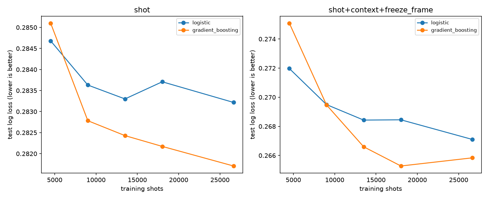
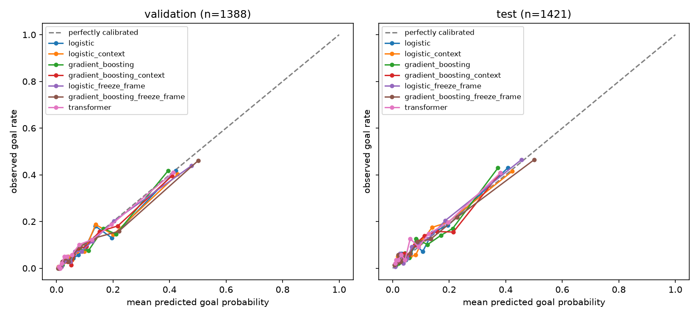

# Will this shot be a goal?

**Which information actually improves the predicted probability that a shot becomes a goal?** This project answers that under fixed, fair conditions: the same shots, the same split, the same models with fixed hyperparameters, and log loss with match-level confidence intervals. Data source: [StatsBomb](#data-source-statsbomb) open data for four 2015/16 leagues (37,888 shots).

## Answer

Test log loss, every shot predicted by a model that never saw its league (leave-one-league-out over four leagues, pooled). Negative is better. Main model: logistic regression; the gradient boosting column checks that the conclusion does not depend on the model.

| information group | added to shot base: logistic | gradient boosting | removed from everything: logistic | gradient boosting |
|---|---|---|---|---|
| defensive shape at shot time (freeze-frame) | **-0.0156** (-0.0173, -0.0139) | **-0.0162** (-0.0181, -0.0143) | **+0.0100** (+0.0086, +0.0114) | **+0.0110** (+0.0094, +0.0126) |
| shot technique | **-0.0049** (-0.0058, -0.0039) | **-0.0044** (-0.0053, -0.0034) | **+0.0008** (+0.0003, +0.0013) | +0.0004 (-0.0000, +0.0008) |
| play situation | **-0.0037** (-0.0046, -0.0029) | **-0.0027** (-0.0035, -0.0018) | -0.0000 (-0.0003, +0.0002) | -0.0001 (-0.0003, +0.0001) |
| build-up (pre-shot context) | **-0.0030** (-0.0038, -0.0021) | **-0.0036** (-0.0046, -0.0027) | -0.0002 (-0.0006, +0.0001) | -0.0002 (-0.0007, +0.0002) |
| penalty flag | **-0.0011** (-0.0015, -0.0006) | **-0.0002** (-0.0004, -0.0000) | +0.0000 (-0.0000, +0.0001) | +0.0000 (+0.0000, +0.0000) |

Bold: the 95% interval excludes zero. "Removed" is everything minus that group, compared with everything; a positive number means the group carried information nothing else had.

1. **The defensive shape at shot time is the one large, irreplaceable signal.** Adding it lowers log loss by ~0.016; removing it from the full model costs ~0.010. Both directions agree, for both models, in every one of the four held-out leagues.
2. **Shot technique is the only other group that adds something unique** (volley, lob, first-time, aerial). Removing it costs +0.0008 for the logistic model, and the effect has the same sign for gradient boosting, whose interval just touches zero.
3. **Build-up, play situation and the penalty flag help on their own, but are redundant once the rest is known.** Each lowers log loss when added to the shot base, and none is missed when removed from the full model.
4. **Build-up on top of the freeze-frame adds little or nothing:** -0.0006 (-0.0011, -0.0000) for logistic regression, -0.0002 (-0.0006, +0.0002) for gradient boosting. Per league, the interval excludes zero in only one of four. The defensive picture at the moment of the shot already holds most of what the possession that led to it can tell.

For scale, StatsBomb's own xG (a reference row, never an input) scores 0.2517 on the same shots. The full logistic model scores 0.2543 and the full gradient boosting model 0.2534, with no hyperparameter search.

## Question and setup

| league (2015/16) | matches | shots | goal rate | shots without a freeze-frame |
|---|---|---|---|---|
| La Liga | 380 | 9,168 | 11.06% | 0.88% |
| Premier League | 380 | 9,908 | 9.97% | 0.74% |
| Serie A | 380 | 9,998 | 9.51% | 1.17% |
| Ligue 1 | 377 | 8,814 | 10.39% | 0.94% |

- **Target**: `P(goal | shot)`. Saved, blocked, off-target and woodwork shots are 0.
- **Metric**: log loss (primary). Accuracy is not a criterion: always predicting "no goal" already scores ~90%.
- **Split**: leave one league out. Train on three leagues, test on the fourth, four times; every shot is predicted exactly once, out of league. Validation is 15% of the training leagues' matches, used only to pick the number of boosting rounds. This answers whether a finding carries over to a league the model has never seen.
- **Uncertainty**: shots within a match are related, so intervals come from a paired bootstrap that resamples whole matches (2,000 draws, 95%), pooled over all four test leagues. Per-league intervals are in `comparison.csv`.
- **Fixed models**: the hyperparameters are the same fixed values as in the published benchmark below. Nothing is searched on validation; searching would mostly fit noise.
- **Two checks per group**: *add* (shot base + that group vs shot base) asks whether the group carries information; *remove* (everything minus that group vs everything) asks whether that information is available nowhere else. The two disagree exactly when groups overlap.

Competition and season ids are not hard-coded: `make data-multi` looks them up by name in `sb.competitions()`.

## Information groups

Shot base, used by every model: `distance_to_goal`, `angle_to_goal`, `body_part` (foot, head, other) and `is_set_piece` (corner, free kick, penalty, kick-off).

| group | columns | source |
|---|---|---|
| freeze-frame | goalkeeper distance to goal, goalkeeper offset from goal centre, shot-to-goalkeeper distance, nearest outfield opponent, opponents and teammates in the triangle (shot, two posts), opponents between shot and goal, `has_freeze_frame`, `has_goalkeeper` | `shot.freeze_frame` |
| technique | `shot_technique` (normal, half volley, volley, lob, backheel, diving header, overhead kick), first-time, aerial won | shot event |
| play situation | `play_pattern` (regular play, counter, corner, free kick, throw-in, ...), `under_pressure` | shot event |
| build-up | events, passes, carries and opponent actions earlier in the possession, possession time, time since the previous event, the previous event type, progression over the last 16 events | earlier events of the same possession only |
| penalty | `is_penalty` | `shot_type` |

Deliberately not used: `shot_end_location` (it is the outcome), `shot_statsbomb_xg` (kept only as the reference row), and `shot_one_on_one` / `shot_open_goal` (analyst judgements that restate the freeze-frame by hand and would blur the comparison).

**Why the penalty flag looks redundant.** Penalties score 75% (400 shots) against 6.6% for other set pieces, so they must be separated, and the flag does help on its own. But 88.5% of penalties have no freeze-frame, and `play_pattern` labels them `Other` (69% goal rate). So `has_freeze_frame` and `play_pattern` already identify them, and the remove check reads near zero. The information is real; it is just encoded three times.

Build-up features are leakage-safe by construction: only events with a lower `index` than the shot, in the same match and possession, can reach a feature (`pre_shot.py`). `tests/test_pre_shot.py` deletes or corrupts every later event and requires identical output.

## Choosing the model: learning curve

Gradient boosting usually needs more data than logistic regression before it pays off. Before choosing between them, both were fitted on nested training sets of growing size: one match-level 70/15/15 split pooled over the four leagues, with fixed validation (5,608 shots) and test (5,639 shots) sets.

| training shots | shot base: boosting - logistic | shot + build-up + freeze-frame: boosting - logistic |
|---|---|---|
| 4,514 | +0.0004 (-0.0025, +0.0033) | +0.0031 (-0.0007, +0.0069) |
| 9,009 | -0.0008 (-0.0033, +0.0015) | -0.0000 (-0.0034, +0.0032) |
| 13,507 | -0.0009 (-0.0034, +0.0016) | -0.0018 (-0.0051, +0.0015) |
| 18,015 | -0.0015 (-0.0039, +0.0008) | **-0.0032 (-0.0062, -0.0000)** |
| 26,641 | -0.0015 (-0.0039, +0.0008) | -0.0013 (-0.0045, +0.0020) |



Gradient boosting overtakes logistic regression at around 9,000 shots, consistent with the published La Liga benchmark, where it was trained on 6,359 shots and did not win. The rule, fixed before the run, was to switch to gradient boosting only if its 95% interval sat below zero for both feature sets at the largest training size. It does not, so **logistic regression is the main model** and gradient boosting is kept as a check column. The gap is about 0.0015 nats either way, and every conclusion above holds for both models.

## Published benchmark: La Liga only (unchanged)

The first benchmark is kept exactly as published: La Liga 2015/16 (`competition_id=11`, `season_id=27`), split by `match_id` 70/15/15 (seed 42; train 6,359, validation 1,388, test 1,421 shots), test never seen during fitting. `make data-multi` checks that its La Liga rows reproduce `data/shots.parquet`, `data/shot_context.parquet` and `data/shot_freeze_frame.parquet` digit for digit.

| model | features | val log loss | test log loss | test Brier | test log loss vs logistic (95% CI) |
|---|---|---|---|---|---|
| prior | none | 0.3276 | 0.3578 | 0.1021 | |
| logistic | shot | 0.2603 | 0.3023 | 0.0859 | baseline |
| logistic_context | shot + pre-shot | 0.2596 | 0.3012 | 0.0855 | -0.0011 (-0.0078, +0.0053) |
| gradient_boosting | shot | 0.2612 | 0.3039 | 0.0876 | +0.0017 (-0.0052, +0.0083) |
| gradient_boosting_context | shot + pre-shot | 0.2593 | 0.3024 | 0.0870 | +0.0001 (-0.0069, +0.0072) |
| logistic_freeze_frame | shot + freeze-frame | 0.2457 | 0.2891 | 0.0831 | **-0.0131 (-0.0242, -0.0018)** |
| gradient_boosting_freeze_frame | shot + freeze-frame | 0.2447 | 0.2894 | 0.0836 | **-0.0129 (-0.0239, -0.0021)** |
| transformer | shot + 16-event sequence | 0.2598 | 0.3048 | 0.0869 | +0.0025 (-0.0055, +0.0107) |

On one league, only the freeze-frame rows were distinguishable from noise. The four-league benchmark agrees on the freeze-frame and adds a finer answer for build-up: its standalone gain (-0.0011 here, interval across zero) becomes clear with four times the data (-0.0030), but it is largely redundant once the freeze-frame is known. The Transformer reads the last K = 16 events of the possession (type, location, time since the previous event, which side made it); K was chosen once, as the median shot follows 13 events. Five seeds (ad-hoc check) gave test log loss from 0.2989 to 0.3059, a range that contains the baseline.



*Correction:* an earlier version of this README said about 4% of shots lack a freeze-frame. The measured share is 0.88% for La Liga (0.7-1.2% across leagues). The benchmark numbers above are unaffected.

## Where it fails

- **One season.** Four leagues, all 2015/16. Leaving out a league tests transfer across competitions, not across seasons or eras.
- **Small effects.** Apart from the freeze-frame, every gain is below 0.005 nats. The intervals are honest about match-level noise, but they come from one seed and one assignment of validation matches.
- **Static snapshot.** The freeze-frame has positions only. Velocity, body orientation and the goalkeeper's set position are not represented.
- **No player identity.** The probability is for an average shooter. Finishing skill and goalkeeper quality are not modelled.
- **No tuning.** The hyperparameters are fixed defaults. A tuned gradient boosting model may do better; this project compares information, not model capacity.
- **Build-up features are coarse.** Pass height, cross, through-ball and cut-back flags are not used, so "build-up adds little" holds for these features, not for every possible description of build-up.

## Run it

```bash
make install         # local uv, Python 3.12, and .venv
make data            # published La Liga benchmark: data/*.parquet
make benchmark       # outputs/metrics.csv, log_loss_vs_logistic.csv, calibration.png
make data-multi      # four leagues: data/multi_league/*.parquet, checks La Liga reproduces exactly
make learning-curve  # outputs/multi_league/learning_curve.{csv,png}
make groups          # outputs/multi_league/groups_*/metrics.csv and comparison.csv
make lint
make check
```

`make groups GROUPS=context,freeze_frame,penalty` runs a subset. The groups were added one at a time in the order penalty, technique, play situation; each stage's output is kept in its own directory.

Dependencies are stable releases pinned in `uv.lock`. See [CONTRIBUTING.md](CONTRIBUTING.md) for workflow and style.

## Data source: StatsBomb

<a href="https://github.com/hudl/open-data"></a>

**Data source: StatsBomb.** All shot, event and freeze-frame data used here comes from [StatsBomb Open Data](https://github.com/hudl/open-data), made freely available by StatsBomb for research and football analytics. Every analysis, table and figure in this repository is based on that data, and this publication is accredited with the StatsBomb logo above, as the [StatsBomb Public Data User Agreement](https://github.com/hudl/open-data/blob/master/LICENSE.pdf) (section 1.4) and the [Terms & Conditions](https://github.com/hudl/open-data#terms--conditions) require. The logo is StatsBomb's, from their [Media Pack](https://statsbomb.com/media-pack/).

- **Non-commercial.** This is a personal research and portfolio project. Neither the data nor any analysis derived from it is used commercially.
- **No redistribution.** The data remains the property of StatsBomb and is not included in this repository. `make data` and `make data-multi` download it from StatsBomb Open Data at run time; the derived `data/` and `outputs/` folders are not committed.
- **Not StatsBomb's view.** The analysis and conclusions here are the author's own and are not necessarily the opinions or analytical insights of StatsBomb.

## License

The source code in this repository is released under the [MIT License](LICENSE). The MIT License covers the code only.

StatsBomb data, any analysis, results and figures derived from it, and the StatsBomb logo are not covered by the MIT License. They remain subject to the [StatsBomb Public Data User Agreement](https://github.com/hudl/open-data/blob/master/LICENSE.pdf), which among other things forbids redistributing the data and using it, or analysis derived from it, commercially.
